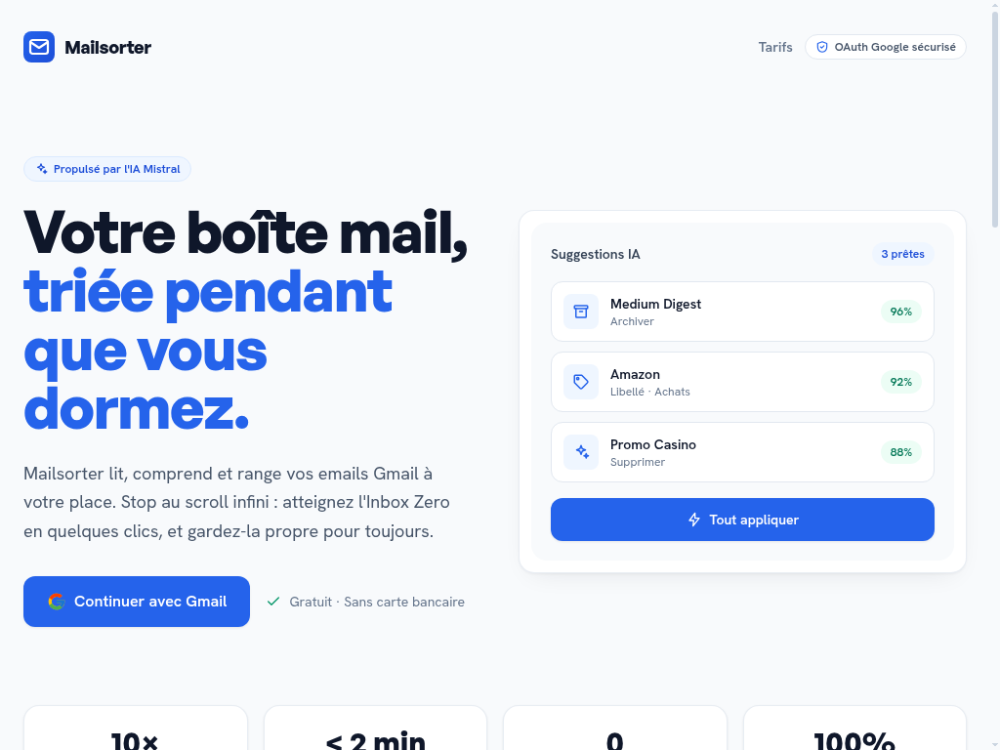
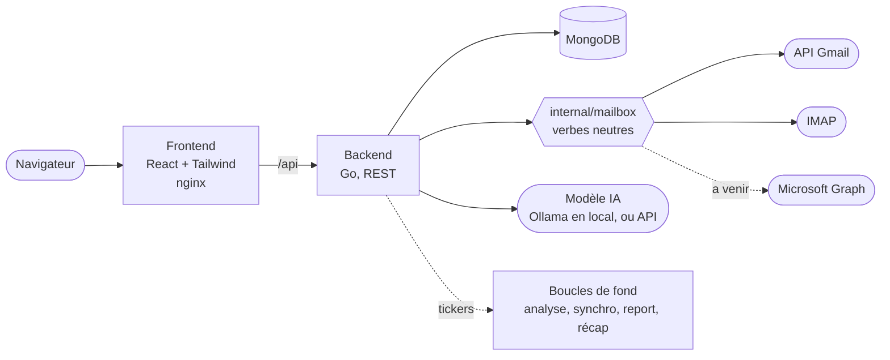

<div align="center">

# Mailsorter

**L'IA lit, comprend et range votre boîte mail à votre place.**

[Service géré](https://mailsorter.sohbi.dev) | `Go` | `React + Tailwind` | `MongoDB` | IA : `Ollama` en local, `Mistral`, `OpenAI` ou `Anthropic` | MIT



</div>

---

Une boîte qui déborde se vide de deux façons : à la main, pendant des heures, chaque semaine ; ou en déléguant la décision. Mailsorter délègue, sans retirer la main à l'utilisateur : chaque proposition de l'IA arrive avec un score de confiance et attend votre validation, et chaque action appliquée est journalisée. Sur une boîte branchée par l'API Gmail, elle s'annule d'un clic.

**Mailsorter s'installe chez vous.** Vous clonez, vous lancez, et vos identifiants restent sur votre machine. C'est la façon recommandée de l'utiliser, et c'est aussi la seule qui donne accès à l'API Gmail complète et à Proton.

**Et l'IA peut tourner chez vous aussi.** Avec un fournisseur d'IA en ligne, l'expéditeur, le sujet et un court extrait de chaque email analysé partent chez lui. Branchez un modèle local avec [Ollama](https://ollama.com) et l'analyse ne sort plus de votre réseau : ni coût par analyse, ni dépendance à un service extérieur. Voir [IA locale](#ia-locale).

## Deux éditions

Ce n'est pas une question d'emballage : l'édition décide de ce que l'instance peut atteindre.

| | Auto-hébergée | Service géré |
|---|---|---|
| | `EDITION=self-hosted` (par défaut) | `EDITION=hosted` |
| **Qui l'exploite** | Vous | Nous |
| **Prix** | Gratuit, MIT | Gratuit jusqu'à 200 analyses IA par mois ; Pro sans limite |
| **Gmail** | **API complète**, avec votre propre projet Google Cloud, ou IMAP + mot de passe d'application | IMAP + mot de passe d'application |
| **Proton** | Oui, via Bridge, sur la machine du backend | Impossible |
| **IA** | Un modèle local, ou votre clé d'API | Celle de l'instance |
| **Vos identifiants** | Restent chez vous | Chez nous, chiffrés |

Dans les deux éditions, chaque compte peut aussi brancher sa propre clé d'IA depuis les Réglages.

Sur Gmail, l'auto-hébergée est **strictement meilleure** : un projet Google Cloud personnel vous place dans l'exemption d'usage personnel de Google, donc aucune vérification, aucun audit, aucun plafond. Le service géré ne peut pas faire ça : un client OAuth partagé est plafonné par Google à 100 autorisations pour la durée de vie du projet, et ce plafond n'est pas réinitialisable. Le catalogue des fournisseurs porte cette règle : il ne propose pas l'API Gmail à l'édition gérée.

Le service géré, c'est donc ne pas avoir à s'en occuper. En contrepartie, toutes ses boîtes passent par IMAP, qui ne donne aujourd'hui accès qu'à une partie de l'application (voir [Ce qui passe par quel chemin](#ce-qui-passe-par-quel-chemin)).

## Fournisseurs

Le catalogue vit dans [`backend/internal/provider`](backend/internal/provider/catalog.go) : seize entrées (quinze fournisseurs et "autre serveur IMAP"), dix-huit routes. Chaque édition n'en voit que ses routes, et l'écran de connexion affiche ce que le serveur renvoie (`GET /api/providers`), sans liste de fournisseurs en dur.

### Ce qui se branche aujourd'hui

Le fournisseur est reconnu au domaine de l'adresse, et la connexion part vers le serveur IMAP inscrit au catalogue pour lui.

| Fournisseur | Adresses reconnues | Ce que l'écran vous demande | Édition |
| --- | --- | --- | --- |
| Gmail | `gmail.com`, `googlemail.com` | un mot de passe d'application (validation en deux étapes requise) | les deux |
| Orange | `orange.fr`, `wanadoo.fr` | la clé d'accès générée dans l'espace sécurité du compte | les deux |
| La Poste | `laposte.net` | un mot de passe d'application | les deux |
| iCloud Mail | `icloud.com`, `me.com`, `mac.com` | un mot de passe d'application (double authentification requise) | les deux |
| Fastmail | `fastmail.com`, `fastmail.fr` | un mot de passe d'application | les deux |
| Infomaniak | `ik.me`, `etik.com`, `ikmail.com` | un mot de passe d'appareil, créé dans le Manager (Service Mail, l'adresse, onglet Appareils) | les deux |
| Proton Mail | `proton.me`, `protonmail.com`, `pm.me` | le mot de passe de la boîte, via Bridge (offre payante de Proton) | auto-hébergée |

En auto-hébergé s'ajoutent **Gmail et Google Workspace par l'API Gmail complète** (OAuth), avec votre propre projet Google Cloud : voir [Connecter Gmail par l'API](#connecter-gmail-par-lapi).

**Proton** passe par Bridge, qui n'écoute que sur `127.0.0.1:1143` : le backend doit tourner sur la même machine que Bridge (`make backend` ou `go run`), pas dans Docker. La connexion (STARTTLS) vérifie le certificat avec les autorités de confiance de cette machine, qui doit donc reconnaître celui de Bridge.

### Au catalogue, pas encore branchables

Free, SFR, Yahoo et AOL, Zoho, OVH, Google Workspace par IMAP et tout autre serveur IMAP : leur serveur doit être trouvé par autodécouverte (enregistrements SRV du domaine, puis base de configuration de Mozilla), qui n'est pas encore écrite. Outlook.com et Microsoft 365 passent par l'API de Microsoft (Graph), pas encore branchée. L'application les affiche "bientôt", et une tentative de connexion répond qu'aucune route IMAP n'existe pour cette adresse.

### Ce qui passe par quel chemin

Par l'API Gmail, tout est branché.

Sur une boîte IMAP, Mailsorter synchronise la boîte de réception, l'affiche avec ses filtres (non lus, aujourd'hui, favoris, pièces jointes, volumineux), analyse les emails avec l'IA et range : archiver, supprimer, marquer comme lu, mettre en favori, appliquer ou ignorer une proposition de l'IA (archiver, supprimer, classer, garder), et annuler (juste après, après un rangement ou depuis l'historique : le mail revient de là où Mailsorter l'avait mis). Sur une boîte IMAP, l'étiquette est un dossier : appliquer une proposition de classer un mail dans "Factures" le range dans le dossier "Factures" de la boîte, créé s'il n'existe pas, et il quitte la boîte de réception, comme un archivage. L'IA ne voit pas vos dossiers : le nom qu'elle propose est rapproché ensuite, chez Mailsorter, de vos dossiers existants ("Facture" va dans votre "Factures"). Les règles tournent aussi : à la demande, après un aperçu, sur la boîte telle que l'écran la montre, et, si vous activez l'option, à chaque synchronisation sur les mails qui arrivent après l'activation et après le branchement de la boîte (la toute première synchronisation n'en range aucun), pas sur ceux déjà là ni sur un mail remis par "Annuler". Une règle n'y classe pas encore dans un dossier. Débrancher la boîte efface sa copie et les propositions de l'IA en attente : une autre boîte branchée ensuite repart de zéro. Le récap quotidien part aussi : par le serveur d'envoi de la boîte (SMTP, celui du fournisseur au catalogue), connecté avec l'adresse et le mot de passe d'application de la boîte, de votre adresse à votre adresse. Le lecteur montre les pièces jointes d'un mail et les télécharge telles qu'elles ont été envoyées, et dessine à leur place les images que le mail intègre. Le reste passe encore par l'API Gmail et répond `501` sur une boîte IMAP : le report, le désabonnement, les actions sur une sélection (dont classer à la main) et sur tout un expéditeur.

## Ce qu'elle fait

**Trier.** L'IA reçoit l'expéditeur, le sujet et un extrait tronqué de chaque email, et propose une action (archiver, supprimer, étiqueter, garder) avec un score de confiance et une raison. Vous validez au cas par cas, par expéditeur, ou tout d'un geste.

**Ne pas repasser par l'IA.** Deux raccourcis passent avant le modèle : un cache d'analyses indexé sur l'expéditeur et le sujet, partagé entre tous les utilisateurs, et, sur l'API Gmail, le pilote automatique par expéditeur, qui applique l'action apprise sans appeler le modèle. Ni l'un ni l'autre ne compte dans le quota.

**Des règles sans IA.** Un moteur de règles déterministes : conditions sur `from`, `subject`, `snippet`, `to`, `body` (contient, égal, commence par, finit par, regex, négations, plus vieux ou plus récent que N jours) vers une ou plusieurs actions enchaînées. Les règles ne passent pas par le modèle et ne comptent pas dans le quota. Elles s'appliquent à la demande, après un aperçu qui ne change rien, et, si vous activez l'option, à chaque synchronisation. Elles tournent sur les deux chemins (sur une boîte IMAP, l'option ne range que les mails qui arrivent, et une règle n'y classe pas encore dans un dossier), et l'analyse par l'IA ne les consulte pas.

**Couper le robinet.** Détection des newsletters via les en-têtes `List-Unsubscribe` (RFC 2369) et `List-Unsubscribe-Post` (RFC 8058), désabonnement exécuté côté serveur quand l'expéditeur le permet, puis archivage du backlog de l'expéditeur dans le même geste. Le désabonnement passe par l'API Gmail.

**Tourner sans vous.** Synchronisation de fond, au plus toutes les 30 minutes, application des règles à chaque synchronisation, et récap quotidien des sept derniers jours envoyé depuis votre propre boîte, si vous les activez. Sur l'API Gmail, en plus : report d'emails qui reviennent tout seuls au moment choisi.

**Ne rien casser.** Une liste d'expéditeurs protégés qu'aucune passe automatisée (IA, règle, pilote automatique, action groupée) ne peut archiver ni supprimer, ni, sur une boîte IMAP, classer dans un dossier, un journal de toutes les actions avec un bouton Annuler qui rejoue l'action inverse (sur une boîte IMAP, le mail revient de là où Mailsorter l'avait mis), et un export ou une suppression RGPD complète en un clic.

## Installation

Prérequis : Docker et Docker Compose. Pour l'IA, au choix : un modèle local avec Ollama (voir [IA locale](#ia-locale)), ou une clé [Mistral](https://console.mistral.ai/), OpenAI ou Anthropic.

```bash
git clone https://github.com/nohe-sohbi/Mailsorter.git
cd Mailsorter
cp .env.example .env
```

Renseignez au minimum :

```env
EDITION=self-hosted
ENCRYPTION_KEY=collez-ici-une-cle-aleatoire-de-32-caracteres-minimum

# L'IA, au choix : un modèle local (voir "IA locale")
OLLAMA_MODEL=qwen3.5:9b
# ou une clé Mistral
# MISTRAL_API_KEY=votre_cle_mistral
```

Générez une vraie clé de chiffrement, par exemple avec `openssl rand -base64 32`. **Le serveur refuse de démarrer sans clé, avec moins de 32 caractères, ou sur une valeur d'exemple** (celle ci-dessus comme celle de `.env.example`). Changer cette clé plus tard déconnecte tout le monde et rend illisibles les identifiants stockés : jetons Google, mots de passe des boîtes, clés d'IA personnelles.

```bash
make up
```

| Surface | URL |
| --- | --- |
| Application | http://localhost:3000 |
| API | http://localhost:8080 |
| Santé | http://localhost:8080/health |

Un port déjà pris sur votre machine ? `FRONTEND_PORT=3300`, `BACKEND_PORT=8181` ou `MONGO_PORT` dans le `.env`. Ils ne déplacent que le côté hôte : dans les conteneurs, le backend écoute toujours sur 8080. `make up` affiche les adresses réellement publiées.

`make up` empile `docker-compose.yml` et `compose.local.yml`, ce second fichier publiant les ports sur l'hôte. Un `docker compose up` seul démarre la pile sans rien exposer : le fichier principal est celui du déploiement, où le routage passe par un proxy.

### Premiers pas

Ouvrez l'application, créez un compte (une adresse et un mot de passe de 8 caractères au moins), puis branchez votre boîte depuis l'écran Connecter : par Google si l'instance a ses identifiants Google (ci-dessous), sinon par IMAP, avec l'identifiant que le fournisseur vous donne.

### Connecter Gmail par l'API

Pour la pleine fidélité sur Gmail, créez **votre propre** projet Google Cloud. Vous en êtes l'unique utilisateur, ce qui vous place dans l'exemption d'usage personnel : ni vérification, ni audit de sécurité, ni plafond.

1. Créez un projet sur [console.cloud.google.com](https://console.cloud.google.com/), activez l'API Gmail.
2. Configurez l'écran de consentement, puis **cliquez sur Publier l'application**. Sans ce clic vous restez en mode Test et votre autorisation expire tous les sept jours.
3. Créez un identifiant OAuth de type **Application Web** (pas Desktop) avec `http://localhost:3000/auth/callback` en URI de redirection.
4. Reportez l'identifiant et le secret dans votre `.env` :

```env
GMAIL_CLIENT_ID=votre_client_id.apps.googleusercontent.com
GMAIL_CLIENT_SECRET=votre_client_secret
GMAIL_REDIRECT_URL=http://localhost:3000/auth/callback
```

Un écran d'avertissement Google apparaît à la connexion : c'est normal, vous consentez à une application que vous avez créée vous-même.

Sans ces identifiants, une adresse Gmail se branche quand même, par IMAP avec un mot de passe d'application.

### Connecter un autre fournisseur

Selon le fournisseur, l'écran Connecter demande un mot de passe d'application que vous générez chez lui, ou celui que Proton Mail Bridge affiche : voir [le tableau des fournisseurs](#ce-qui-se-branche-aujourdhui). Il vous dit lequel, et ce qui peut bloquer la connexion, depuis le même catalogue que celui avec lequel le serveur se connecte. La connexion est essayée avant d'être enregistrée, et l'identifiant est stocké chiffré (AES-256-GCM) : aucune route ne le renvoie.

## IA locale

Une boîte mail contient des factures, des relevés bancaires, des échanges privés. Avec un modèle local, l'analyse reste sur votre réseau : aucun extrait ne part chez un fournisseur d'IA, l'analyse ne coûte rien et tourne même si un fournisseur tombe.

### Lancer avec Ollama

1. Installez [Ollama](https://ollama.com) et téléchargez un modèle :

   ```bash
   ollama pull qwen3.5:9b
   ```

2. Faites écouter Ollama au-delà de la boucle locale, sinon le conteneur ne le voit pas : `OLLAMA_HOST=0.0.0.0` dans l'environnement d'Ollama, puis redémarrez-le.

3. Dans votre `.env`, nommez le modèle et laissez `MISTRAL_API_KEY` vide (sinon Mistral passe en premier, voir plus bas) :

   ```env
   OLLAMA_MODEL=qwen3.5:9b
   ```

4. `make up`, puis vérifiez dans `make logs` que le backend annonce `AI providers initialized: ollama`.

Par défaut, `make up` cherche Ollama sur la machine qui fait tourner Docker (`http://host.docker.internal:11434`, nom résolu sur Linux aussi). Si le modèle tourne sur un autre ordinateur, celui qui a la carte graphique par exemple, donnez son adresse :

```env
OLLAMA_BASE_URL=http://192.168.1.50:11434
```

Ollama n'a pas d'authentification : écouter sur `0.0.0.0` l'ouvre à tout votre réseau local. Gardez-le sur un réseau de confiance, ou restreignez le port au pare-feu.

### Choisir un modèle

Le modèle reçoit les emails par lots de 8 et doit répondre en JSON : une action, une étiquette, un score de confiance et une raison. Le cache passe avant lui, et sur l'API Gmail le pilote automatique par expéditeur aussi : il ne voit que ce qui n'a pas encore été jugé.

| Mémoire de la carte graphique | Point de départ (novembre 2026) | Poids |
| --- | --- | --- |
| 8 Go | Qwen3.5 9B : `qwen3.5:9b` | 6,6 Go |
| 16 Go | Qwen3.8 27B, quantifié IQ4_XS : `hf.co/unsloth/Qwen3.8-27B-GGUF:UD-IQ4_XS` | 14,4 Go |

Sur 16 Go, prenez la quantification IQ4_XS ci-dessus : le `qwen3.8:27b` du catalogue Ollama pèse 18 Go et déborde de la carte, ce qui renvoie une partie du calcul sur le processeur. Les modèles ouverts changent tous les mois et tout modèle qui répond en JSON convient : ce tableau donne un point de départ, pas une liste fermée.

Mailsorter demande au modèle de ne pas réfléchir à voix haute (`think: false`) : les modèles qui raisonnent avant de répondre, comme Qwen, le font sinon par défaut, et un tri n'a besoin que d'une réponse courte. Si le modèle tarde quand même, l'erreur le dit (`ollama timeout`) au lieu de parler de réseau.

Plus le modèle est gros, moins il se trompe sur les cas limites, et c'est ce qui compte avant de le laisser agir en tâche de fond. Le pilote automatique ne supprime ni n'archive jamais un expéditeur protégé, quel que soit le modèle.

### llama.cpp, LM Studio, vLLM

Tout serveur compatible OpenAI convient. `OPENAI_BASE_URL` est l'adresse complète de la route de chat, et la clé n'est pas lue par un serveur local mais ne doit pas être vide :

```env
OPENAI_BASE_URL=http://host.docker.internal:1234/v1/chat/completions
OPENAI_API_KEY=local
OPENAI_MODEL=le-nom-du-modele-charge
```

### Plusieurs fournisseurs, et le repli

Chaque fournisseur configuré dans le `.env` entre dans la liste, dans cet ordre : Mistral, OpenAI, Anthropic, Ollama. `AI_FALLBACK_PROVIDER` fait passer celui qu'il nomme juste après Mistral. Sur une erreur transitoire (429, erreur 5xx, délai dépassé, serveur injoignable), le suivant prend le relais ; une erreur définitive (clé refusée, requête invalide) s'arrête là.

Modèles par défaut : `mistral-small-latest` (Mistral), `gpt-6-luna` (OpenAI), `claude-haiku-5-5` (Anthropic). Ollama n'entre dans la liste que si `OLLAMA_MODEL` est renseigné.

### Pourquoi dans le `.env` et pas dans les Réglages

L'écran Réglages laisse chaque compte brancher sa propre clé (Mistral, OpenAI, Anthropic, Ollama ou un serveur compatible OpenAI), essayée avant celles de l'instance. Mais une adresse saisie là est contrôlée à l'enregistrement et au test : elle doit être en `https`, et ni `localhost`, ni un nom en `.local`, ni une adresse IP privée écrite en chiffres n'est acceptée. Un nom de domaine n'est pas résolu à ce moment-là. Un modèle sur votre réseau est un choix de l'instance : il se règle dans le `.env`, par celui qui l'installe.

Les variables `OLLAMA_*`, `OPENAI_*`, `ANTHROPIC_*` et `AI_FALLBACK_PROVIDER` sont transmises au conteneur par `compose.local.yml`, le fichier qu'empile `make up`, ou lues directement par `make backend`. Le `docker-compose.yml` du déploiement ne transmet que `MISTRAL_*`.

## Ce qui est intéressant dedans

Les décisions d'ingénierie qui valent le détour, avec leur point d'entrée dans le code.

| | |
|---|---|
| **Le moteur de règles est pur** | [`internal/rules`](backend/internal/rules) ne fait aucune I/O : il prend des emails et des règles, il rend des décisions. L'aperçu et l'application réelle reposent sur la même fonction de correspondance, donc l'aperçu ne peut pas mentir sur ce qui va se passer. |
| **Aucun gestionnaire ne connaît les libellés de Gmail** | [`internal/mailbox`](backend/internal/mailbox/mailbox.go) tient le vocabulaire neutre des actions et sa traduction par transport. Les identifiants système de Gmail (`INBOX`, `TRASH`, `UNREAD`, `STARRED`) apparaissaient 51 fois dans l'arbre ; ils ne vivent plus que dans cette traduction et dans le client Gmail. L'IMAP a la sienne à côté, en dossiers et en drapeaux. |
| **L'édition est une donnée, pas un commentaire** | [`internal/provider`](backend/internal/provider/catalog.go) déclare quelle route est offerte dans quelle édition, et un test refuse que le catalogue propose un jour l'API Gmail à l'édition gérée. C'est le genre de règle qu'on redécouvre autrement au 101e utilisateur. |
| **L'IA coûte cher, on l'évite** | Cache d'analyses indexé sur `sha256(from\|subject)` et **partagé entre tous les utilisateurs** : un email déjà jugé pour quelqu'un d'autre ne repasse pas par le modèle. Les appels restants partent par lots de 8, avec repli automatique email par email si la réponse ne s'aligne pas. |
| **Un 429 ne doit pas ruiner un lot** | Les clients Gmail et Mistral réessaient les erreurs transitoires avec backoff exponentiel et jitter, en honorant `Retry-After`, plafonnés pour rester dans les timeouts serveur ; OpenAI et Anthropic réessaient avec le même backoff. Les 4xx échouent vite, et le registre passe au fournisseur d'IA suivant. |
| **Des sessions sans bibliothèque** | Le jeton de session est un HMAC-SHA256 maison, expirant, signé avec une clé dérivée du secret maître par un label distinct de celle du `state` OAuth : un jeton de session ne peut pas être rejoué comme state. Le middleware supprime systématiquement l'en-tête `X-User-Email` fourni par le client avant de le reposer lui-même. |
| **Les identifiants ne dorment pas en clair** | Jetons Google, mots de passe des boîtes et clés d'IA personnelles sont chiffrés en AES-256-GCM avant d'atteindre la base. Les anciens jetons Google en clair sont rescellés à la première lecture, et un jeton illisible devient un 401 qui relance la connexion, jamais un 500. |
| **Un seul catalogue de données** | [`internal/account`](backend/internal/account/account.go) déclare une fois la liste des collections détenues par un utilisateur, et cette liste pilote **à la fois** l'export et la suppression RGPD. Impossible d'exporter une donnée qu'on ne sait pas effacer, ou d'effacer une donnée qu'on n'a jamais divulguée. |
| **Le récap part de votre compte** | Aucun SMTP tiers : le récap quotidien part de la boîte de l'utilisateur lui-même, par l'API Gmail, ou par le serveur d'envoi de sa boîte IMAP avec son propre mot de passe d'application ([`internal/smtpsend`](backend/internal/smtpsend/smtpsend.go) : TLS obligatoire, certificat vérifié). |

## Architecture



| Brique | Stack | Rôle |
| --- | --- | --- |
| Frontend | React 18, Tailwind, Axios | Cockpit de tri, design system maison, zéro librairie d'icônes |
| Backend | Go 1.26, Gorilla Mux, OAuth2, go-imap | API REST, orchestration IA, accès aux boîtes, boucles de fond |
| Base | MongoDB 7 | Comptes, miroir de la boîte, suggestions, règles, journal d'actions |
| IA | Ollama ou tout serveur compatible OpenAI en local ; Mistral, OpenAI, Anthropic en API ; repli automatique de l'un à l'autre | Classification des emails |

Détail : [`docs/ARCHITECTURE.md`](docs/ARCHITECTURE.md). API complète : [`docs/API.md`](docs/API.md). Historique des phases : [`docs/ROADMAP.md`](docs/ROADMAP.md).

## Développement

```bash
make backend                        # le backend seul sur :8080, après avoir chargé .env
make frontend                       # le frontend de développement sur :3000
cd backend && go test -race ./...   # tests unitaires et d'intégration
make scenarios                      # scénarios d'acceptation, contre un MongoDB jetable
```

`make backend` a besoin d'un MongoDB joignable : `make up` en publie un sur `127.0.0.1:27017`.

Les scénarios d'acceptation (`backend/internal/api/scenarios_*_test.go`) décrivent chacun en une phrase ce que fait l'application, et le prouvent contre un vrai MongoDB. Ils portent le tag `acceptance` : `go test ./...` ne les voit pas. `make scenarios` les joue contre un MongoDB jetable (Docker, ou un `mongod` téléchargé) et imprime un rapport en français.

La CI (`.github/workflows/ci.yml`) tourne à chaque push sur `main` et sur chaque PR : `gofmt`, `vet`, `build` et `test -race` sur le backend, les scénarios contre un MongoDB, le build du frontend, et la construction des deux images Docker.

La carte du dépôt, les conventions et les pièges connus : [`CLAUDE.md`](CLAUDE.md).

## API en un coup d'oeil

| Méthode | Endpoint | Description |
| --- | --- | --- |
| `POST` | `/api/auth/register`, `/api/auth/login` | Création de compte et connexion par adresse et mot de passe |
| `GET` | `/api/providers` | Les fournisseurs joignables par cette édition |
| `POST` | `/api/mailbox/connect` | Branche une boîte par IMAP, après avoir essayé la connexion |
| `GET` | `/api/emails` | Liste paginée de la boîte (sans les corps) |
| `GET` | `/api/emails/{id}` | Un message avec son corps décodé et ses pièces jointes |
| `POST` | `/api/emails/action` | Action directe sur un message |
| `POST` | `/api/emails/batch-action`, `/batch-undo` | Une action sur toute une sélection, et sa réversion |
| `POST` | `/api/emails/snooze` | Reporte un email, qui revient tout seul |
| `POST` | `/api/ai/analyze` | Suggestions de tri (cache, puis lots) |
| `POST` | `/api/ai/analyze-async` | Job d'analyse non bloquant, avec progression |
| `GET` | `/api/rules`, `POST` `/api/rules/preview` | Règles déterministes et leur aperçu |
| `GET` | `/api/subscriptions`, `POST` `/api/unsubscribe` | Newsletters détectées, désabonnement |
| `GET` | `/api/activity/log`, `POST` `/api/activity/undo` | Journal des actions et annulation |
| `GET` | `/api/account/export`, `DELETE` `/api/account` | Export et suppression RGPD |
| `GET` | `/health`, `/metrics` | Ping MongoDB, build, uptime, compteurs |

Les 79 routes (70 chemins) et leurs charges utiles : [`docs/API.md`](docs/API.md).

## Licence

MIT. Faites-en ce que vous voulez.
