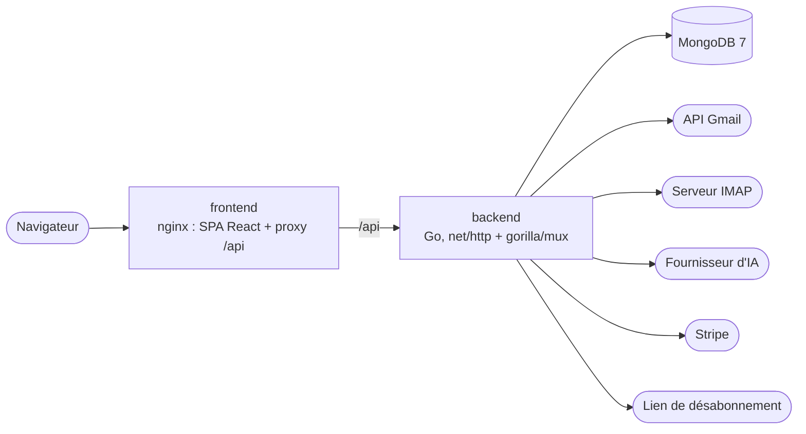

# Architecture de Mailsorter

Ce document donne la vue d'ensemble et les flux principaux. La carte détaillée du code (paquet par paquet, fichier par fichier), les conventions et les pièges connus sont dans [`CLAUDE.md`](../CLAUDE.md) ; chaque route et sa charge utile, dans [`API.md`](API.md). En cas de désaccord, le code fait foi.

## Vue d'ensemble



Trois conteneurs, décrits par `docker-compose.yml` : `mongodb`, `backend` (port 8080) et `frontend` (nginx, port 80). En production, Dokploy route le domaine vers `frontend`, et nginx relaie `/api` vers `backend:8080` : aucun appel inter-origines. Ce fichier ne publie aucun port ; en local, `make up` lui ajoute `compose.local.yml`, qui publie le frontend sur 3000, le backend sur 8080 et MongoDB sur `127.0.0.1:27017`.

## Briques

**Backend (`backend/`).** `cmd/server` charge et valide la configuration, se connecte à MongoDB, crée les index, construit les clients (chiffrement, Gmail, IA, Stripe), monte les routes et sert, avec un arrêt propre sur SIGTERM. `internal/api` est la seule couche qui fait des entrées-sorties : gestionnaires HTTP, middlewares, boucles de fond. La logique de décision vit dans des paquets purs, sans I/O et testés à part : `rules`, `protect`, `snooze`, `search`, `schedule`, `activity`, `digest`, `mailer`, `account`, `metrics`, `provider`, `mailbox`, `egress`, `unsubscribe`. Les clients sortants sont `gmail`, `imap`, `smtpsend`, `ai` et `billing`.

**Frontend (`frontend/`).** Une SPA React 18 (Create React App et Tailwind), servie par nginx. Tous les appels HTTP passent par `src/services/api.js`. L'apparence (`UI_THEME`, "hotel" ou "classic") est lue au démarrage par `GET /api/config/status`.

**Données.** Une base MongoDB `mailsorter`, une collection par usage, toutes déclarées dans `internal/database/database.go`. Les index sont créés au démarrage du backend par `EnsureIndexes`, seule source de vérité ; `mongo-init/` ne crée rien. Tout est rattaché à `userId`, l'adresse du compte, sauf `users` et `waitlist` (indexés sur l'adresse), `gmail_config` (ancienne configuration, en lecture seule) et `analysis_cache`, partagé entre tous les comptes et indexé sur `sha256(version|expéditeur|sujet)` : au démarrage, `EnsureIndexes` efface les entrées d'une autre version.

**Transports.** Une boîte est jointe soit par l'API Gmail (OAuth, avec le client Google de l'instance), soit par IMAP (go-imap v2, TLS ou STARTTLS, jamais en clair ; l'ouverture, connexion, accueil, LOGIN et liste des dossiers, s'arrête avec la requête ou la boucle qui l'a demandée ; un LOGIN refusé n'est un mot de passe refusé que si le serveur le dit, une boîte indisponible ou injoignable est « votre boîte n'a pas répondu »). Le serveur IMAP n'est jamais fourni par le client : il est lu dans le catalogue `internal/provider` d'après le domaine de l'adresse, comme le serveur d'envoi (SMTP) de la même route, enregistré avec la boîte et par lequel part le récap. Le transport est résolu à chaque requête (`transportFor`) : une ligne `mail_accounts` décide ; sans ligne, des jetons Google sur le compte veulent dire API Gmail ; sans l'un ni l'autre, la requête répond `428`. Une erreur de base de données fait échouer la requête, elle ne retombe jamais sur Gmail. Microsoft Graph figure au catalogue mais n'est pas implémenté.

## Entrer dans l'application

1. **Compte.** `POST /api/auth/register` crée un compte par adresse et mot de passe (bcrypt), `POST /api/auth/login` s'y connecte. Les deux rendent un jeton de session.
2. **Google.** `GET /api/auth/url` renvoie l'adresse du consentement Google, avec un `state` signé. Au retour, `GET /api/auth/callback` vérifie le `state`, échange le code, scelle les jetons et rend un jeton de session. Si l'appelant était déjà connecté, le `state` porte son adresse et la boîte Google est rattachée à ce compte ; sinon, le compte est celui de l'adresse Google.
3. **Brancher une boîte.** Depuis l'écran Connecter : par Google (étape 2) quand l'instance a ses identifiants Google, ou par IMAP avec `POST /api/mailbox/connect`, qui essaie la connexion avant d'enregistrer quoi que ce soit.

L'API offre aussi `POST /api/auth/mailbox`, que l'interface n'utilise pas : une adresse et l'identifiant de la boîte, acceptés par le fournisseur, ouvrent ou créent le compte.

## Flux d'une synchronisation

Déclenchée par `POST /api/emails/sync`, ou par la boucle de synchronisation de fond.

```
syncInbox(compte)
  -> openSession : transportFor, puis un client Gmail ou une connexion IMAP
  -> API Gmail : les 100 messages les plus récents de la boîte de réception, corps compris
       -> upsert dans emails, clé (userId, messageId)
       -> si autoApplyRules : première règle qui correspond, expéditeurs protégés épargnés,
          action par internal/mailbox, entrée au journal (source "rule")
  -> IMAP : les 100 messages les plus récents de INBOX, lus en PEEK (aucun \Seen posé)
       -> un FETCH des drapeaux et de la taille de toute la boîte : le numéro de chaque
          mail qui y est encore, lu ou non, en favori ou non, et sa taille
       -> mirror.Judge sur la copie : un mail que la boîte n'a plus part, quel que soit
          son âge ; un mail que Mailsorter a rangé reste caché 30 jours pour "Annuler" ;
          un déplacement en cours ou postérieur à la lecture attend la synchro suivante
       -> les propositions de l'IA sur ce qui est parti passent "moot" (hors du tri proposé)
       -> upsert dans emails avec le dossier, qui fait partie de l'identité d'un UID
       -> les mails en favori que la copie n'a pas encore (un ancien favori), 500 au
          plus par synchro, les plus récents d'abord
       -> lu, favori et taille remis à jour sur chaque mail de la copie, ancien compris ;
          lu et favori gardés tels quels sur un mail changé depuis Mailsorter après la
          lecture des drapeaux (flagsAt) ; l'upsert ne les écrit qu'à la création
       -> pièces jointes (BODYSTRUCTURE) des mails de la copie qui ne les ont pas encore,
          500 au plus par synchro, les plus récents d'abord, lues par lots coupés en deux
          quand la réponse d'un lot ne se lit pas (connexion rouverte, un budget par
          phase) ; un mail illisible seul est noté structureUnreadable, sans pièce
          jointe, et n'est plus redemandé ; un refus du serveur ou un délai ne conclut
          rien sur aucun mail : la synchro répond une erreur, la suivante relit
       -> aucune règle : rulesApplied vaut 0
  -> { synced, total, rulesApplied }
```

Sur IMAP, la liste (`GET /api/emails`), ses filtres (non lus, aujourd'hui, favoris, pièces jointes, volumineux) et les compteurs (`GET /api/stats`) sont ensuite servis depuis ce miroir, sans rouvrir la boîte.

## Flux d'une analyse

```
POST /api/ai/analyze (200 ids au plus) ou POST /api/ai/analyze-async (500, file de 3 workers)
  -> 503 si aucun fournisseur d'IA ; 402 si le quota gratuit du service géré est épuisé
  -> runAnalysis
       -> chaque message est lu dans le miroir, ou récupéré par la session s'il y manque
       -> API Gmail : pilote automatique par expéditeur -> action appliquée tout de suite (source "ai-auto")
       -> cache partagé -> suggestion sans appel au modèle
       -> le reste par lots de 8 -> registre d'IA : la clé du compte d'abord, puis les fournisseurs
          de l'instance par priorité ; erreur transitoire -> fournisseur suivant
       -> un verdict destructeur sur un expéditeur protégé devient "garder"
       -> une suggestion en attente par message ; le quota ne compte que les appels au modèle
  -> POST /api/ai/apply ou /api/ai/apply-batch : application par la session, entrée au journal (source "ai")
```

Les règles déterministes ne font pas partie de ce flux : elles tournent à la synchronisation, ou à la demande par `POST /api/rules/apply`.

## Sécurité

- **Sessions.** Jeton HMAC-SHA256 maison, valable 30 jours, envoyé en `Authorization: Bearer`. Sa clé est dérivée d'`ENCRYPTION_KEY` par un label distinct de celle du `state` OAuth (valable 10 minutes), si bien que l'un ne se rejoue pas comme l'autre. Le middleware supprime tout `X-User-Email` venu du client, vérifie le jeton, puis pose lui-même l'en-tête que lisent les gestionnaires.
- **Mots de passe des comptes.** bcrypt, entre 8 caractères et 72 octets.
- **Identifiants stockés.** Chiffrés en AES-256-GCM avec une clé dérivée d'`ENCRYPTION_KEY` : jetons Google et mots de passe des boîtes par `internal/api/tokens.go`, clés d'IA personnelles par `internal/api/ai_settings.go`. Aucune route ne les renvoie, et l'export RGPD les retire.
- **Tentatives de connexion.** `register`, `login` et `auth/mailbox` partagent un limiteur bien plus strict que le global : environ une tentative toutes les 3 secondes, 5 d'avance, par adresse du visiteur et par adresse email. Le limiteur global est de 20 requêtes par seconde (40 d'avance), par compte ou par adresse du visiteur. Cette adresse vient de `X-Real-IP`, posé par nginx, et n'est crue que d'un pair privé ou local.
- **Entrées.** Corps JSON plafonnés à 1 Mio, erreurs dans une enveloppe JSON unique, en-têtes de sécurité sur chaque réponse, origines CORS limitées à `ALLOWED_ORIGINS`.
- **Requêtes sortantes.** Le désabonnement en un clic, dont l'adresse vient d'un email reçu, passe par `internal/egress` : `https` seulement, adresse publique vérifiée au moment de la connexion, chaque redirection rejugée. L'adresse d'un fournisseur d'IA saisie dans les Réglages n'est contrôlée que sur sa forme, à l'enregistrement et au test.
- **Configuration.** Le serveur refuse de démarrer sans `ENCRYPTION_KEY`, sous 32 caractères ou sur une valeur d'exemple connue (celle d'une ancienne version du README est seulement signalée au démarrage : la refuser bloquerait les instances qui tournent déjà avec), et sur une valeur d'`EDITION` ou d'`UI_THEME` qu'il ne connaît pas.

## Tâches de fond

Quatre boucles, lancées par `NewHandler` : des goroutines avec des tickers, relancées à chaque redéploiement.

| Boucle | Cadence | Rôle |
| --- | --- | --- |
| Workers d'analyse | 3 workers, file de 256 jobs | Exécutent `analyze-async` ; une file pleine lance le job à part |
| Réveil des reports | toutes les minutes | Ramène en boîte, non lus, les emails reportés arrivés à échéance, compte par compte : une session par compte (sur IMAP, une connexion pour tous ses mails, bornée à 30 s ouverture comprise, depuis le dossier "Plus tard" où ils attendaient : un serveur qui se tait au LOGIN ne retient que son compte) ; un échec est retenté au passage suivant, et après 5 échecs le report passe en échec ; un mail qu'un autre logiciel a sorti de "Plus tard" est d'abord cherché dans la boîte de réception (s'il y est, il est revenu : remis non lu) ; ailleurs, il reste où il est, et son report est annulé ; "Annuler" sur un report ramène le mail et annule le report tout de suite, et la boucle, "Annuler" et "Réactiver" réservent le report avant de déplacer le mail, pour qu'il ne soit déplacé qu'une fois |
| Récap quotidien | toutes les 15 minutes, au plus un envoi par jour et par compte | Envoie le récap des 7 derniers jours à l'heure choisie (UTC, 0 = minuit ; sans choix, `DIGEST_HOUR_UTC`), de la boîte du compte à elle-même : par l'API Gmail, ou par le serveur d'envoi d'une boîte IMAP (`internal/smtpsend`, avec son mot de passe d'application) ; une semaine vide n'envoie rien ; quatre comptes à la fois, chacun avec ses 30 s, pour qu'un serveur d'envoi qui ne répond pas ne retienne que le sien |
| Synchronisation de fond | passage toutes les 5 minutes, 30 minutes au moins entre deux synchronisations d'un compte | Synchronise les comptes qui l'ont activée |

## Observabilité

- `GET /health` : ping MongoDB, version (`BUILD_VERSION`) et uptime ; `503` si MongoDB ne répond pas.
- `GET /metrics` : compteurs en mémoire, par méthode et par classe de statut, latence moyenne et maximale, uptime. Cardinalité bornée, aucune donnée d'utilisateur (`internal/metrics`).
- Journaux : une ligne par requête, avec son identifiant (`X-Request-ID`), sa méthode, son chemin, son statut et sa durée.
